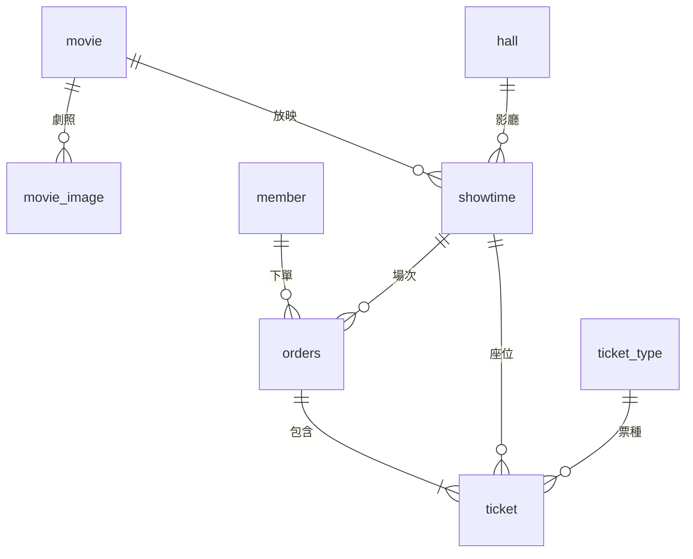

# 🎬 MOVIE POS 電影購票系統（後端）

以 **Spring Boot + Spring Data JPA + MySQL** 開發的線上電影購票系統後端，提供 RESTful API 給 React 前端使用。

購票人可以瀏覽上映中的電影、查看場次、在座位圖上選位並完成購票；管理者可以維護電影、影廳、場次與票種，查詢訂單與會員，並查看銷售報表。


---

## 目錄

- [功能](#功能)
- [使用技術](#使用技術)
- [系統架構](#系統架構)
- [專案結構](#專案結構)
- [資料庫設計](#資料庫設計)
- [API 一覽](#api-一覽)
- [安裝與執行](#安裝與執行)
- [技術重點](#技術重點)
- [待改進](#待改進)

---

## 功能

### 購票端（會員）

- 會員註冊、登入
- 瀏覽上架中的電影（分頁）、電影詳情（劇照、預告片）
- 查詢今天以後的場次
- 座位圖選位：依影廳排數與第一排座位數產生座位圖，標示已售出座位
- 一次選多個座位，每張票可選不同票種，自動計算原價、折扣與實付金額
- 查詢訂單與每張票的座位明細

### 管理端

- 管理者登入
- **電影管理**：新增、修改、上架／下架，並可同時上傳劇照與預告片
- **影廳管理**：新增、修改、刪除；可一次新增影廳與多個場次
- **場次管理**：新增、修改、刪除，同一影廳同一時間不可重複排場
- **票種管理**：新增、修改、刪除票種（售價、折扣率）
- **會員管理**：關鍵字查詢、修改、刪除
- **訂單查詢**：依會員帳號、訂單編號查詢，分頁顯示
- **銷售報表**：本週／本月銷售總表、每日實收、各電影銷售統計

---

## 使用技術

| 分類 | 技術 |
|---|---|
| 語言 | Java 21 |
| 框架 | Spring Boot 4.1（Spring Web MVC） |
| 資料存取 | Spring Data JPA、Hibernate 7 |
| 資料驗證 | Jakarta Bean Validation |
| 資料庫 | MySQL 8 |
| 其他 | Lombok、Spring Boot DevTools |
| 建置工具 | Maven |
| 前端（另一個專案） | React 19、React Router、Vite |
| 測試工具 | Postman |

---

## 系統架構

- **Controller**：接收請求、驗證參數，把 Entity 轉成 Response DTO 後回傳 JSON
- **Service**：商業邏輯與交易管理（`@Transactional`）
- **Repository**：繼承 `JpaRepository`，方法名稱查詢、`@Query` 原生 SQL
- **GlobalExceptionHandler**：集中處理例外，回傳對應的 HTTP 狀態碼與中文訊息

---

## 專案結構

```
src/main/java/com/example/movie
├─ MovieApplication.java      程式進入點
├─ config/                    CORS 設定
├─ controller/                REST API（電影、場次、影廳、票種、訂單、票、會員、管理者、報表）
├─ dao/                       Service：商業邏輯與交易
├─ Repository/                Spring Data JPA Repository
├─ model/                     JPA Entity（對應資料表）
├─ dto/                       Request / Response DTO、分頁回應 PageResponse
├─ exception/                 自訂例外、GlobalExceptionHandler
└─ util/                      SeatRule（座位規則）、PasswordUtil（SHA-256）

src/main/resources
├─ application.properties     資料庫、上傳檔案路徑設定
└─ static/                    前端打包後的檔案（打包 jar 時使用）
```

---

## 資料庫設計

資料庫 `movie_pos` 共 9 張資料表。



| 資料表 | 說明 |
|---|---|
| `movie` | 電影；`is_active` 控制上架／下架 |
| `movie_image` | 劇照、海報、橫幅 |
| `hall` | 影廳；只存排數與第一排座位數 |
| `showtime` | 場次 |
| `ticket_type` | 票種與折扣率 |
| `member` | 會員；密碼存 SHA-256 雜湊值 |
| `orders` | 訂單；記錄原價、折扣、實收 |
| `ticket` | 票；每張票對應一個座位 |
| `admin` | 管理者 |

**重要限制**

| 限制 | 目的 |
|---|---|
| `ticket` UNIQUE (showtime_id, row_no, seat_no) | 同一場次的同一座位不能賣兩次 |
| `showtime` UNIQUE (hall_id, show_date, start_time) | 同一影廳同一時間不能排兩個場次 |
| `movie` UNIQUE (title, release_date) | 同一部電影不重複新增 |
| `member` / `admin` UNIQUE (username) | 帳號不可重複 |

---

## API 一覽

所有 API 以 `/api` 開頭，回傳 JSON。列表 API 支援 `page`、`size` 分頁參數（頁碼從 1 開始）。

| 資源 | 方法 | 路徑 | 說明 |
|---|---|---|---|
| 電影 | GET | `/api/movie` | 上架中電影列表 |
| | GET | `/api/movie/inactive` | 已下架電影列表 |
| | GET | `/api/movie/{id}` | 電影詳情（含圖片） |
| | POST | `/api/movie/add` | 新增電影（multipart，含圖片、預告片） |
| | PUT | `/api/movie/{id}` | 修改電影、上架／下架（multipart） |
| 場次 | GET | `/api/showtime?movieId=` | 場次列表（可依電影篩選） |
| | GET | `/api/showtime/{id}` | 單一場次 |
| | GET | `/api/showtime/upcoming?movieId=` | 今天以後的場次 |
| | GET | `/api/showtime/{id}/seats` | 座位圖（已售／可售） |
| | POST / PUT / DELETE | `/api/showtime`、`/api/showtime/{id}` | 新增、修改、刪除 |
| 影廳 | GET | `/api/hall?hallName=` | 影廳列表（可依廳名查詢） |
| | GET | `/api/hall/{id}` | 單一影廳 |
| | POST | `/api/hall/with-showtimes` | 一次新增影廳與多個場次 |
| | POST / PUT / DELETE | `/api/hall`、`/api/hall/{id}` | 新增、修改、刪除 |
| 票種 | GET | `/api/ticket-type`、`/api/ticket-type/{id}` | 查詢 |
| | POST / PUT / DELETE | `/api/ticket-type`、`/api/ticket-type/{id}` | 新增、修改、刪除 |
| 訂單 | GET | `/api/orders` | 訂單列表（含每張票） |
| | GET | `/api/orders/summary?username=&orderId=` | 後台訂單查詢 |
| | GET | `/api/orders/{id}` | 單一訂單 |
| | POST | `/api/orders` | 下單購票 |
| 票 | GET | `/api/ticket`、`/api/ticket/{id}` | 查詢 |
| 會員 | GET | `/api/member`、`/api/member/search?keyword=` | 列表、關鍵字查詢 |
| | POST | `/api/member` | 註冊 |
| | POST | `/api/member/login` | 登入 |
| | PUT / DELETE | `/api/member/{id}` | 修改、刪除 |
| 管理者 | GET | `/api/admin`、`/api/admin/search` | 列表、查詢 |
| | POST | `/api/admin`、`/api/admin/login` | 新增、登入 |
| | PUT | `/api/admin/{id}` | 修改 |
| | DELETE | `/api/admin/{username}` | 刪除 |
| 報表 | GET | `/api/admin/report/sales?period=week\|month` | 本週／本月銷售總表 |
| | GET | `/api/admin/report/movie-sales?title=` | 各電影銷售統計 |

**常見狀態碼**

| 狀態碼 | 情況 |
|---|---|
| 200 OK | 查詢、修改、刪除成功 |
| 201 Created | 新增成功 |
| 400 Bad Request | 資料驗證失敗、違反規則（例如座位已售出、場次重複） |
| 401 Unauthorized | 帳號或密碼錯誤 |
| 404 Not Found | 找不到資料 |
| 409 Conflict | 帳號已存在 |

---

## 安裝與執行

### 1. 環境需求

- JDK 21
- MySQL 8
- Maven（或使用 Eclipse / IntelliJ 內建的 Maven）

### 2. 建立資料庫

```sql
CREATE DATABASE movie_pos CHARACTER SET utf8mb4;
```

匯入資料表與測試資料：

```bash
mysql -u root -p movie_pos < movie_pos_backup.sql
```

### 3. 修改設定

編輯 `src/main/resources/application.properties`：

```properties
spring.datasource.url=jdbc:mysql://localhost:3306/movie_pos
spring.datasource.username=root
spring.datasource.password=你的密碼

# 劇照、預告片的存放資料夾
app.upload-dir=./static
spring.web.resources.static-locations=classpath:/static/,file:./static/
```

`spring.jpa.hibernate.ddl-auto=validate`：啟動時會檢查資料表結構與 Entity 是否一致，不會自動建表，所以要先匯入 SQL。

### 4. 啟動

**方法 A：開發時**

在 IDE 執行 `MovieApplication.java`，啟動後 API 位於 `http://localhost:8080`。

**方法 B：打包成 jar**

```bash
mvn clean package -DskipTests
java -jar target/movie-0.0.1-SNAPSHOT.jar
```

如果 8080 被占用，可以改用其他 port：

```bash
java -jar target/movie-0.0.1-SNAPSHOT.jar --server.port=8081
```

### 5. 搭配前端

前端是另一個 React 專案（`react-movie`）。

- **開發時**：前端執行 `npm run dev`（`http://localhost:5173`），呼叫本專案的 `http://localhost:8080/api`。CORS 已在 `config/WebConfig.java` 設定。
- **打包成單一 jar**：
  1. 前端執行 `npm run build`
  2. 把 `dist` 裡的檔案複製到本專案的 `src/main/resources/static/`
  3. 重新打包 jar

  `SpaController` 會把 `/movie/**`、`/admin/**` 等前端網址轉給 `index.html`，直接開網址或重新整理頁面都不會 404。

---

## 技術重點

- **購票交易一致**：一筆訂單與多張票在同一個 `@Transactional` 中一起儲存（cascade），任何一張票檢查失敗就整筆取消。
- **座位檢查**：下單時檢查排號範圍、同一訂單不重複選位、座位未售出；資料庫另有 UNIQUE 限制作為最後防線。
- **座位規則 `SeatRule`**：每排座位數 = 第一排座位數 + (排號 − 1)，座位圖 API 依此產生，並標示 SOLD / AVAILABLE。
- **票價計算**：折扣率使用 `BigDecimal`，避免小數誤差；訂單同時記錄原價、折扣與實收。
- **檔案上傳**：以 `MultipartFile` 接收劇照與預告片，檢查格式後寫入資料夾，資料庫只存路徑；寫檔失敗會刪除已存檔案並取消交易。
- **統一例外處理**：`@RestControllerAdvice` 集中處理找不到資料、驗證失敗、資料庫約束錯誤、上傳檔案過大等情況。
- **DTO**：輸入與輸出使用 Request / Response DTO，不直接回傳 Entity，避免密碼外洩與延遲載入問題。
- **銷售報表**：原生 SQL 的 `JOIN`、`GROUP BY`、`SUM` 統計，以介面投影（View）接收結果；用 `java.time` 計算本週、本月區間。
- **分頁**：列表統一使用 `Pageable` 與 `PageResponse` 回應格式。
- **密碼**：會員與管理者密碼以 SHA-256 雜湊後儲存。

---

