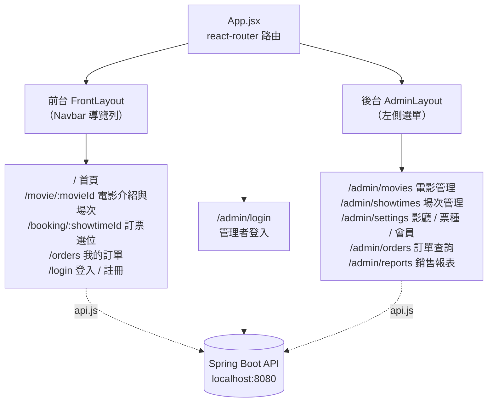

# 🎬 MOVIE POS 電影購票系統（前端）

以 **React + Vite** 開發的電影購票系統前端，搭配 Spring Boot 後端（`movie` 專案）的 RESTful API 使用。

網站分成「購票端」與「管理端」：購票人可以瀏覽電影、查看場次、在座位圖上選位並完成購票；管理者可以維護電影、場次、影廳、票種與會員，並查詢訂單與銷售報表。

> 巨匠電腦 Java 職前訓練班 個人專題
> 作者：游曉雯　｜　指導老師：張庭禎

---

## 目錄

- [畫面與功能](#畫面與功能)
- [使用技術](#使用技術)
- [網站架構](#網站架構)
- [專案結構](#專案結構)
- [安裝與執行](#安裝與執行)
- [打包與部署](#打包與部署)
- [開發說明](#開發說明)

---

## 畫面與功能

### 購票端

| 網址 | 頁面 | 功能 |
|---|---|---|
| `/` | 首頁 | 主視覺、上架中電影列表（分頁） |
| `/movie/:movieId` | 電影介紹與場次 | 海報與劇照輪播、電影資訊、預告片、今天以後的場次 |
| `/booking/:showtimeId` | 訂票選位 | 依影廳產生座位圖（白色未售、藍色已選、灰色已售），每個座位選擇票種並計算合計 |
| `/orders` | 我的訂單 | 訂單與每張票的座位、票種、票價，可列印電影票 |
| `/login` | 會員登入／註冊 | 以頁籤切換登入與註冊 |

### 管理端

| 網址 | 頁面 | 功能 |
|---|---|---|
| `/admin/login` | 管理者登入 | 未登入時無法進入後台 |
| `/admin/movies` | 電影管理 | 上架中／已下架頁籤，新增、編輯（含圖片與預告片上傳）、上架、下架 |
| `/admin/showtimes` | 場次管理 | 依電影篩選，新增、編輯、刪除場次 |
| `/admin/settings` | 影廳／票種／會員 | 三個頁籤，新增、編輯、刪除；會員可用關鍵字搜尋 |
| `/admin/orders` | 訂單查詢 | 依會員帳號、訂單編號查詢並分頁，點選訂單展開每張票明細 |
| `/admin/reports` | 銷售報表 | 本週／本月實收、訂單數、票數、折扣，每日實收長條圖，各電影銷售 |

---

## 使用技術

| 分類 | 技術 |
|---|---|
| 語言 | JavaScript（ES Module）、HTML、CSS |
| 框架 | React 19 |
| 路由 | React Router 7 |
| 建置工具 | Vite 8 |
| 程式檢查 | ESLint |
| 後端（另一個專案） | Spring Boot 4、Spring Data JPA、MySQL |

---

## 網站架構



- 所有頁面透過 `src/api.js` 呼叫後端 API。
- 會員與管理者的登入資料存在瀏覽器的 `localStorage`（`member`、`admin`）；`AdminLayout` 檢查不到管理者登入時，會導回 `/admin/login`。

---

## 專案結構

```
react-movie/
├─ index.html                 網頁進入點
├─ package.json               套件與指令
├─ vite.config.js             Vite 設定
├─ public/                    logo、favicon
└─ src/
   ├─ main.jsx                把 <App /> 放進網頁
   ├─ App.jsx                 路由設定
   ├─ api.js                  後端網址、request / requestPage、登入資料存取
   ├─ assets/                 圖片
   ├─ css/                    各頁樣式（common.css 為共用）
   ├─ components/
   │  ├─ FrontLayout.jsx      前台外框（Navbar + 頁面內容）
   │  ├─ Navbar.jsx           上方導覽列
   │  ├─ Dialog.jsx           訊息對話框
   │  ├─ SectionHeading.jsx   區塊標題
   │  └─ admin/
   │     ├─ AdminLayout.jsx   後台外框（左側選單 + 頁面內容）
   │     ├─ MovieForm.jsx     電影新增／編輯表單（含檔案上傳）
   │     ├─ HallsTab.jsx      影廳頁籤
   │     ├─ TicketTypesTab.jsx 票種頁籤
   │     ├─ MembersTab.jsx    會員頁籤
   │     ├─ Modal.jsx         彈出視窗
   │     ├─ Pager.jsx         分頁按鈕
   │     └─ FormErrors.jsx    表單錯誤訊息
   └─ pages/
      ├─ HomePage.jsx         首頁
      ├─ MovieDetailPage.jsx  電影介紹與場次
      ├─ BookingPage.jsx      訂票選位
      ├─ OrdersPage.jsx       我的訂單
      ├─ LoginPage.jsx        會員登入／註冊
      └─ admin/
         ├─ AdminLoginPage.jsx    管理者登入
         ├─ AdminMoviesPage.jsx   電影管理
         ├─ AdminShowtimesPage.jsx 場次管理
         ├─ AdminSettingsPage.jsx 影廳／票種／會員
         ├─ AdminOrdersPage.jsx   訂單查詢
         └─ AdminReportsPage.jsx  銷售報表
```

---

## 安裝與執行

### 1. 環境需求

- Node.js 20 以上（含 npm）
- 後端 `movie` 專案（Spring Boot）已啟動在 `http://localhost:8080`

### 2. 安裝套件

```bash
npm install
```

會依照 `package.json` 自動下載套件到 `node_modules`（這個資料夾不放在 GitHub 上）。

### 3. 啟動開發伺服器

```bash
npm run dev
```

打開瀏覽器到 **http://localhost:5173**。

畫面要有資料，後端必須同時啟動；後端沒開時，頁面會顯示無法連線的錯誤訊息。

### 常用指令

| 指令 | 說明 |
|---|---|
| `npm run dev` | 啟動開發伺服器（修改程式會自動更新畫面） |
| `npm run build` | 打包成正式版，輸出到 `dist/` |
| `npm run preview` | 在本機預覽打包後的結果 |
| `npm run lint` | 用 ESLint 檢查程式 |

---

## 打包與部署

可以把前端打包進後端的 jar，只要啟動一個程式就能使用整個網站。

1. 前端執行：

   ```bash
   npm run build
   ```

2. 把 `dist/` **裡面的所有檔案**（`index.html`、`assets/`、`logo.svg`…）複製到後端專案的 `src/main/resources/static/`。
   注意是複製 `dist` 裡面的內容，不是整個 `dist` 資料夾。
3. 後端重新打包 jar，啟動後打開 **http://localhost:8080**。

後端的 `SpaController` 會把 `/movie/**`、`/admin/**` 等前端網址轉給 `index.html`，直接輸入網址或重新整理頁面都不會出現 404。

---

## 開發說明

### 後端網址

`src/api.js` 依執行方式自動決定後端網址：

```js
export const API = import.meta.env.DEV ? 'http://localhost:8080' : '';
```

| 執行方式 | `import.meta.env.DEV` | 呼叫的後端 |
|---|---|---|
| `npm run dev` | `true` | `http://localhost:8080` |
| `npm run build` 後放進 jar | `false` | 同一個網站（不用寫網址） |

### 共用的 API 呼叫

- `request(url, { method, body })`：送出請求，失敗時丟出後端回傳的錯誤訊息；`body` 是 `FormData` 時（檔案上傳）直接送出，其他轉成 JSON。
- `requestPage(url)`：查詢分頁列表，後端回傳 404 時視為空的列表。

### 刪除規則

影廳、票種、會員、場次的刪除會先跳出確認視窗。已經被使用的資料（例如已排場次的影廳、已有訂單的會員）會被資料庫外鍵擋下，畫面會顯示「刪除失敗」與原因。
